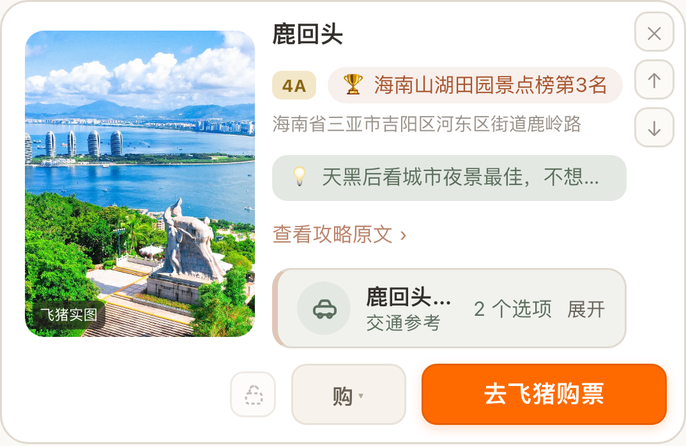
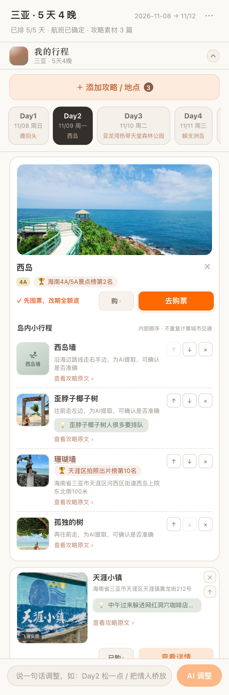
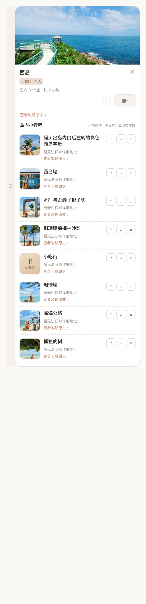
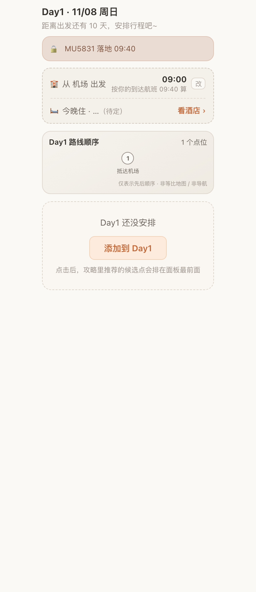
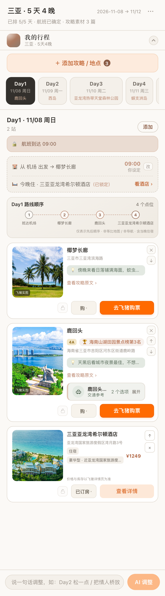
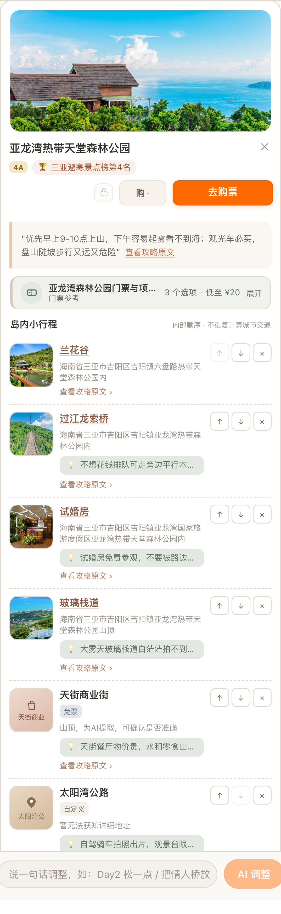

# GoPlay（去玩）· 参赛提交稿

> 本文档按官方模板逐节填写，参赛必填项已补齐。团队名称暂按个人参赛口径填 `joey717`，最终以提交人确认为准。
> 文中所有事实均来自仓库代码与自测记录；不包含任何密钥、环境变量真实值或 `.env` 内容。

---

## 一、参赛项目名称

- **项目名称**：GoPlay（去玩）
- **一句话定位**：AI 旅行行程编排移动端网页应用——粘贴攻略 → 候选池 → 说一句话排一版 → 拖拽只动受影响的天。

## 二、团队与提交人

| 字段 | 内容 |
|---|---|
| 团队名称 | `joey717`（个人参赛口径，暂定；最终以提交人确认为准） |
| 唯一主要提交人 GitHub ID | `joey717`（主页 https://github.com/joey717，作为唯一联系入口） |
| 联系方式 | 按比赛要求仅留 GitHub 主页入口，不提供手机号 / 邮箱 / 微信等私人联系方式 |

## 三、旅行场景与目标用户

- **场景**：自由行行前规划与行中调整。用户手里往往已经有零散素材——小红书攻略、朋友推荐、已订好的机票酒店——但缺少一个把「素材 → 候选点位 → 每日行程 → 行中微调」串起来的工具。
- **目标用户**：做攻略嫌累、又不放心把行程全交给 AI 的自由行人群（亲子游、带父母出行等「有硬约束」的场景尤其典型）。
- **产品主张**：AI 是编排助手而不是决策者。手工操作与「说一句话」能力完全对等；AI 的每一次改动都以可审查的操作集形式提出，经服务端护栏校验后才落地；已锁定的安排 AI 不可推翻。

## 四、我做了什么（核心功能与创新点）

1. **双通道对等 + 操作集输出**：手工编辑与自然语言指令收敛到同一套操作执行器；模型只返回带 `reason` 的操作集（七类意图、八个操作名），而非整份行程，天然可审查、可回滚。
2. **四条服务端护栏（不信任模型）**：操作合法性、候选池边界（AI 新增点位必须先经真实搜索验证）、锁定与约束保护、重排保护；被丢弃操作占比超 30% 整批拒绝，行程逐字段不变。
3. **拖拽局部重算（改一处只动一处）**：同日改序只重算当天顺序 + 相邻交通 + 当日时间轴，其他天逐字段不变，且不经过模型。
4. **约束锁定（锁只锁 AI 不锁人）**：已锁定/已购项 AI 不可改动；用户自己拖动时弹二次确认，锁标记全程保留。
5. **攻略草案 pending + 相似亮点聚类**：多篇攻略合并去重、相似亮点聚类标注「N 处 / N 篇」；草案以待采纳（pending）状态呈现，用户确认后才应用到行程，绝不自动落库。
6. **大景区父卡 + 岛内小行程**：如「西岛」「亚龙湾热带天堂森林公园」以父卡驱动子玩法渲染，内部顺序不重复计城市交通，逐子点独立配图。
7. **酒店片区校验两段式**：先选片区再选酒店；片区半径/本地标记过滤、最多 3 候选，无法确认归属的结果一律丢弃。
8. **只读分享 + OG 打标**：分享页现读脱敏快照（不含攻略原文/原图/来源链接），访客只能标记购票/订房状态；服务端为爬虫注入 OG meta，社交平台预览有标题有封面。
9. **移除 = 移回候选池 + 5 秒撤销**：手工移除不弹确认、给撤销 toast；AI 移除先出提案卡片确认。移除不是删除，点位随时可再排入。
10. **飞猪 FlyAI 真实商品闭环**：POI 与酒店全部来自飞猪实时搜索，带真实跳转链接，不写死假数据；未收录点位静默降级为自定义点位，不伪造链接与图片。

## 五、百炼使用说明（必填）

### 5.1 运行时链路

纯 HTTP REST + SSE 直连百炼 **Managed Agent 专用端点**，未使用任何 SDK：

```
POST /sessions                       创建会话
GET  /sessions/{id}/events/stream    订阅 SSE（Accept: text/event-stream）
POST /sessions/{id}/events           发送用户 Event
     读取事件流直到 session_status = idle / terminated
POST /sessions/{id}/archive          收尾归档
```

- base URL 形如 `https://{BAILIAN_WORKSPACE_ID}.cn-beijing.maas.aliyuncs.com/api/v1/agentstudio`（北京地域）。
- SSE 事件类型含 `session_status` / `text` / `model_request_start` / `model_request_end` / `tool_call`；`text` 事件拼接为最终输出后解析归一化。
- 多轮复用：同组连续意图复用同一 Session（续接前用 `GET /sessions/{id}` 判定状态，非 idle 一律降级新建）；闲置或切换实体时显式 archive。
- 整链路 60 秒超时（AbortController）；**失败不自动重放**，避免重复计费。
- 鉴权为 `Authorization: Bearer` 环境变量中的 DashScope Key；日志只报「已配置/未配置」计数，绝不打印值。
- 模型输出**不被信任**：解析后必须通过 shared 层四条护栏才允许落地。

### 5.2 使用环节与输入输出形态

| 环节 | 入口 | 输入 | 输出 |
|---|---|---|---|
| F11 运行时 AI 意图编排 | `POST /api/ai/intent` | 行程摘要 + 候选池 + 约束 + 用户自然语言意图 + 固定规则文本 | 带 `reason` 的操作集 JSON（七类意图八操作） |
| F5 攻略正文抽取 | `POST /api/ai/extract` | 攻略/笔记正文 | 点位列表 → 逐个经 FlyAI `search_poi` 真实对齐后入候选池 |
| 攻略草案生成 | `POST /api/guides/trips/:id/draft` | 多源攻略合并 mentions + 补充句 + scope | 草案（operations + snippets + 选项组），pending 待用户确认 |
| 截图 OCR | File API（`POST /files` 上传 → 轮询可用 → 图文识别 → `DELETE /files` 即删） | 攻略截图图片 | 结构化文本，进入笔记归属与抽取链路 |

> 说明：百炼会话无独立 system 通道，系统指令以固定规则文本嵌入 user message 顶部（OperationSet 输出契约）。截图 OCR 链路已实现，但产品侧入口当前为禁用态（视觉模型可用性待核实，见 README「当前限制」），如实申报。

### 5.3 Skill / 工具

- 唯一外部 Skill：`@fly-ai/flyai-cli` **v1.0.16**（精确锁版本），子命令 `search-poi` / `search-hotels`。
- 接入方式：服务端子进程直连（bundle 直跑、失败回落 npx），90 秒超时；输出归一化为 `FliggyPoi` / `HotelCandidate`。
- 分工：百炼是「大脑」（意图理解、操作集/抽取/草案/OCR 输出），FlyAI 是「手脚」（真实 POI/酒店商品搜索）；FlyAI 同时充当护栏 2「候选池边界」的校验器。

### 5.4 模型名称与代码位置

- **模型名称**：**Qwen3.8-MAX**——由百炼 Managed Agent 控制台侧挂载并路由，仓库代码不硬编码模型名。
- **能力形态**：Managed Agent（SSE 短会话），后端以 SSE 透传客户端直连其专用端点（见 5.1）。
- **代码位置**：位于本开发仓库内（非独立运行时仓库）——百炼客户端 [`server/src/bailian/client.ts`](../../server/src/bailian/client.ts)，AI 抽取与意图编排流水线 [`server/src/ai/`](../../server/src/ai/)。
- **输入 / 输出**：输入为攻略文本与用户自然语言意图；输出为结构化行程操作集（operations）与亮点片段（snippets）。

### 5.5 其他技术栈

- Node.js 22 + TypeScript 5.6+（实测 5.9）
- 前端：React 18 + Vite 6 + dnd-kit（触控拖拽）
- 后端：Hono 4（@hono/node-server）
- 工程：npm workspaces monorepo（shared 纯契约库 / server / web），shared 承载类型、操作执行器、四条护栏与时间轴计算的唯一实现
- 测试：vitest + @testing-library/react；自研评测 harness + Playwright 截图取证

## 六、效果展示

以下截图均取自真实运行数据（三亚 5 天 4 晚示例行程），存放于 `docs/contest/assets/`：

| 截图 | 说明 |
|---|---|
|  | 行程总览：Day 条 + 路线顺序条 + POI 卡 + 酒店卡 + 底部意图栏 |
|  | 单景点卡：榜单徽标 + 攻略亮点 snippet + 购票状态 + 飞猪购票跳转 |
|  | 西岛大景区父卡 + 岛内小行程子玩法（逐子点配图、可上移/下移/移除） |
|  | 父卡 8 子点位逐点配图（含无图回退占位） |
|  | 酒店卡：图片 + 星级 + 参考价 + 已订房/查看详情 |
|  | snippet 绿色 chip 打开「攻略原文」抽屉并定位高亮提及 |
|  | 出发时间来源标签在移动端窄屏不溢出 |
|  | 拖拽改序后的行程总览对照 |
|  | 父卡转化行：购票入口 + 子玩法亮点 chip |
|  | 只读分享页：脱敏快照，访客仅可标记购票/订房状态 |
|  | 攻略草案浮层展开态：9 项调整明细待确认，应用后才落行程 |

> **演示视频**：由提交人另行提供（不随仓库打包）。上表 11 张截图为真实运行界面，已随仓库存放于 [`docs/contest/assets/`](assets/)，可直接查看，未新造截图。

## 七、项目链接与复现方式

- **仓库地址**：`https://github.com/joey717/GoPlay`。
- **复现步骤**（摘自 README）：

```bash
# 环境要求：Node.js 22+；可访问阿里云百炼与飞猪 FlyAI 的网络
npm install            # npm workspaces 一次性安装 shared / server / web
cp .env.example .env   # 填入四个百炼变量与 FlyAI Key（变量名见 .env.example，密钥不入库）
npm run dev            # concurrently 同时拉起 server 与 web
```

> **密钥不随包提供（重要）**：本仓库不含任何真实 API Key / Token / 凭证；`.env.example` 全部为空值占位（只有变量名，无值），真实 `.env` 已被 `.gitignore` 排除、从不入库。复现者需自行到阿里云百炼控制台与飞猪 FlyAI 平台申请密钥，填入本地 `.env`（4 个百炼变量 + 1 个 FlyAI Key）后才能跑通真实搜索与 AI 链路。密钥缺失时系统按 `ENV_NOT_CONFIGURED`（百炼侧）/ `FLYAI_NOT_CONFIGURED`（FlyAI 侧）安全降级——返回可读错误提示，不崩溃、不伪造数据、不静默回落共享试用通道。详见仓库根 [`SECURITY.md`](../../SECURITY.md)。

| 服务 | 地址 |
|---|---|
| Web | http://localhost:5173 |
| Server | http://localhost:8787 |
| 健康检查 | `GET http://localhost:8787/api/health` → `{"status":"ok"}` |

- 演示路径：初始化向导（目的地/日期/约束/片区意向）→ 粘贴攻略抽取入候选池 → 「说一句话」排一版（七类意图例句见 README 演示指引）→ 拖拽改序观察局部重算 → 生成攻略草案并确认应用 → 打开只读分享页。
- **最终版本**：本次提交为参赛最终版本，三包（shared / server / web）版本标识均为 `0.1.0`（见各 `package.json`）。
- **体验条件**：纯本地运行，无需注册登录账号；需自备百炼 API Key 与 FlyAI Key（缺失时按上文 `ENV_NOT_CONFIGURED` / `FLYAI_NOT_CONFIGURED` 安全降级，不阻断启动）。

## 八、踩坑记录

1. **百炼 SSE 间歇回显 user prompt 致 JSON 解析失败**：finalText 可能是「prompt 回显 + 真实输出」的拼接，「首 `{` → 末 `}`」截取必败。解法：增加「最后一个顶层平衡 JSON 块」兜底 + 「从末次业务起始标记向后平衡扫描」二级兜底。
2. **FlyAI 响应字段漂移**：POI 报文新增/缺字段（如 `description`、`ticketInfo=null`）。解法：按字段特征识别记录而非固定 schema，nullable 安全转换 + URL 白名单校验后放行。
3. **dnd-kit PointerSensor 与 TouchSensor 混挂误杀拖拽**：触摸端「能拖但松手不生效」，系两 sensor 竞争 dispatch DragCancel。解法：手柄式只注册 PointerSensor + CSS `touch-action:none`，两者绝不同挂。
4. **React StrictMode 双挂载令存活 ref 永久失效**：服务端毫秒返回但 UI 卡「生成中」。根因是 cleanup 置 false 的存活标记在双挂载下未复位。解法：存活标记在 effect 体内复位，并补 StrictMode wrapper 回归测试。
5. **串行 FlyAI 装配无预算封顶成耗时黑洞**：逐条串行搜索最坏 N×90s。解法：入口记 deadline（120s 预算），耗尽即 break 返回部分结果、来源落 partial 可重试，不静默丢弃。
6. **后台 dev 进程 SIGTTIN 挂起**：后台启动未重定向 stdin 致进程树 T 态、端口 LISTEN 但不 accept、信号杀不掉。解法：启动补 `< /dev/null`，健康判定必须 curl 探活而非看日志。

## 附：必填项补齐记录

| 字段 | 位置 | 状态 |
|---|---|---|
| 团队名称 | 第二节 | 已填 `joey717`（个人参赛口径，暂定；最终以提交人确认为准） |
| 联系方式 | 第二节 | 已定：仅留 GitHub 主页入口，不留私人联系方式 |
| 模型名称 | 第 5.4 节 | 已填 `Qwen3.8-MAX`（百炼控制台 Managed Agent 挂载） |
| 仓库地址 | 第七节 | 已填 `https://github.com/joey717/GoPlay` |

## 附：资产与敏感信息自查

- 截图 01–09 取自开发期取证库存（/tmp 与 eval-report/v2/evidence），10–11 为提交前对 dev 环境（5173/8787）补拍；全部为真实运行界面，未做内容伪造。
- 已逐张目检：截图内不含手机号、邮箱、身份证等 PII，不含任何密钥/Token/`.env` 内容；分享页截图为脱敏快照形态。
- 示例行程数据中的攻略来源链接含平台跟踪参数（非鉴权密钥），仅存在于本地运行时数据（不入库），未进入本文档与截图资产。
