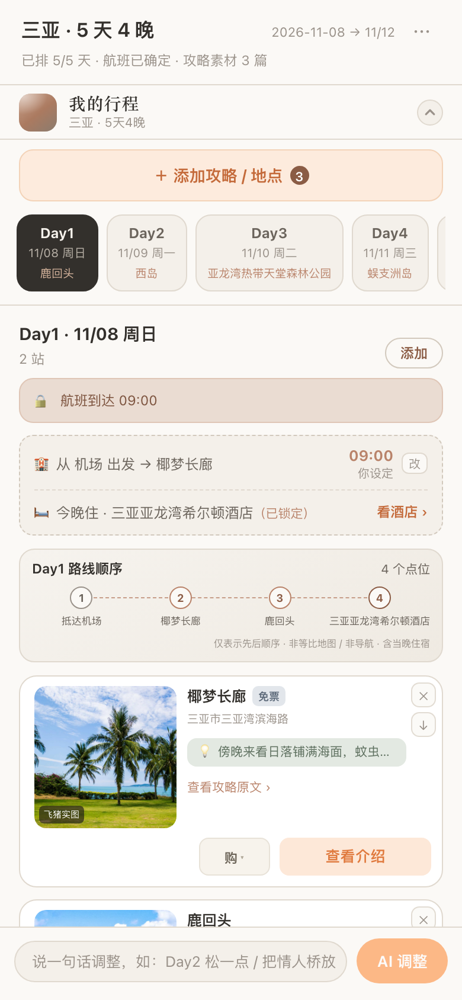
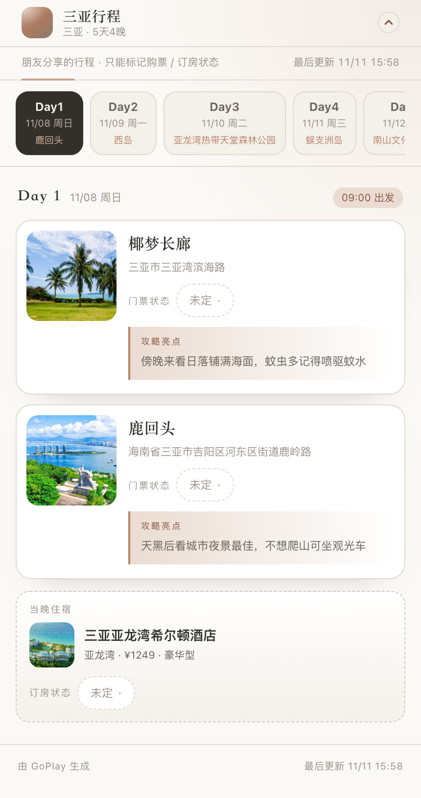
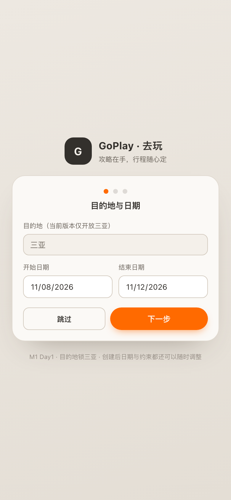
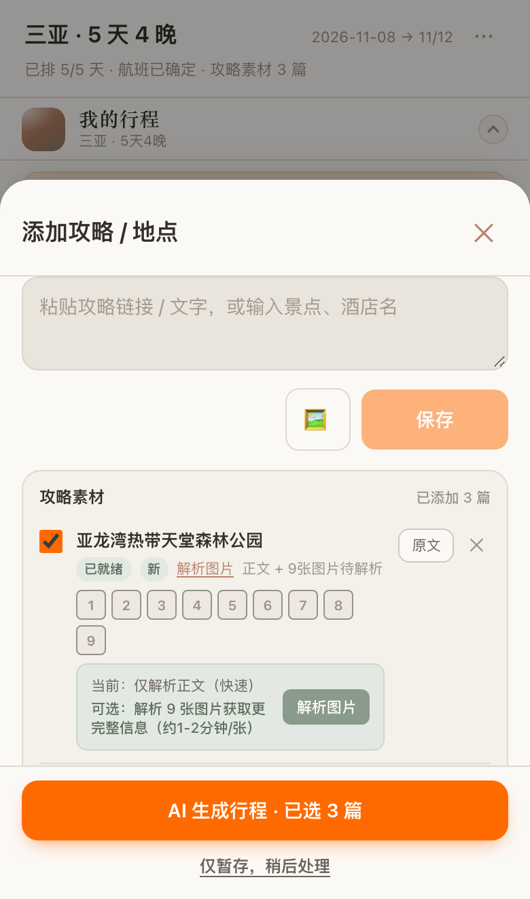
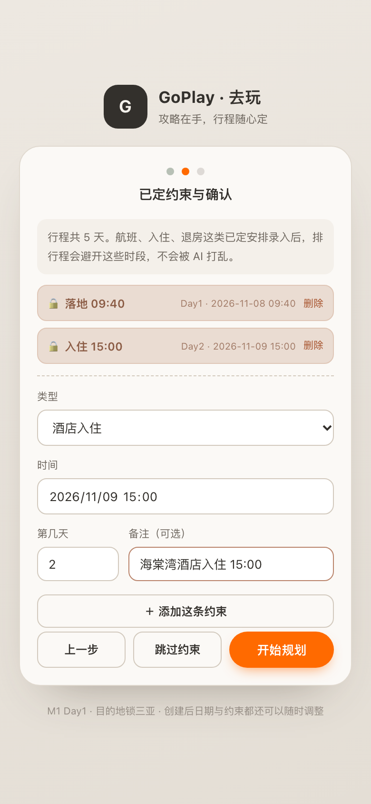
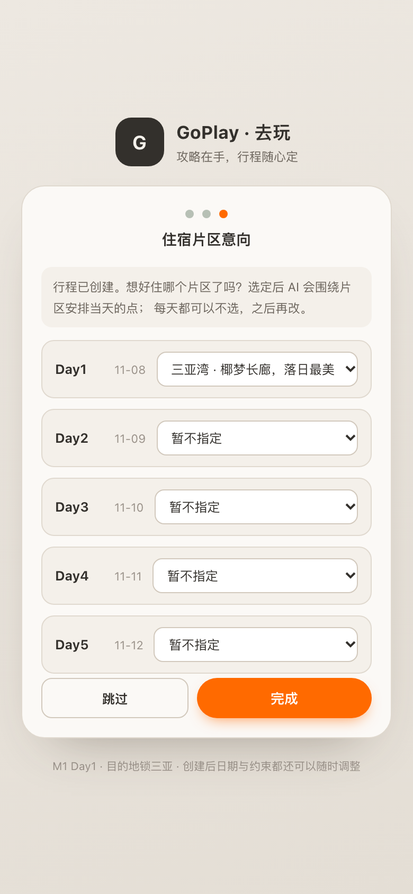

# GoPlay（去玩）· 参赛提交稿

## 一、参赛项目名称

- **项目名称**：GoPlay（去玩）
- **一句话定位**：把散落攻略，变成一份照着就能走的行程。

## 二、团队与提交人

| 字段 | 内容 |
|---|---|
| 唯一主要提交人 GitHub ID | `joey717`（主页 https://github.com/joey717，作为唯一联系入口） |

## 三、旅行场景与目标用户

- **场景**：针对较复杂的行程（如4—5天多人自由行），不是缺少攻略，而是信息分散、安排不断变化、预订进度协同、以及担心同行人对安排不满意。通用 AI 虽能生成行程，但用户仍需进行查证；调整行程时，还可能打乱已经确定的机票、酒店和门票。
- **目标用户**：计划4—5天自由行，尤其是多人结伴出行的行程组织者及同行人。
- **产品主张**：让规划有依据、调整有边界、执行有协同，把“想去”变成“能出发”。
GoPlay 不只是替用户生成一份旅行建议，而是以用户选择的攻略为起点，用 AI 将碎片信息转化为可执行的多日行程，并通过预订管理与多人协同，让旅行从“有想法、有攻略”，真正走向“安排清楚、准备完成、放心出发”。

## 四、我做了什么（核心功能与创新点）
-  **核心创新** ：以用户选定的攻略为信息依据、可手动微调行程或自然语言调整输入、以已购项目为重排约束，让 AI 从一次性生成旅行内容，升级为可核验、可调整、可协同的行程规划。
- 1.**将多篇攻略组合成可核验的结构化行程** 
支持持续添加不同来源的攻略，由 AI 抽取景点、打卡点、游玩亮点和注意事项，形成按天安排、顺序清晰的行程，并可细化到景区内的打卡路线。相关内容保留攻略原文入口，让 AI 的组合结果方便追溯与核验。
- 2.**让 AI 按用户意图调整行程，同时守住已购安排** 
支持手动增删、排序和一句话 AI 调整；标记为已购的机票、酒店和门票会转化为锁定约束，后续重排只调整未确定部分。用户决定“想要什么、什么不能变”，AI 负责“如何组合、如何调整“。
- 3.**将预订管理嵌入行程，而非另建一张清单** 
购买状态直接关联具体行程项，门票和酒店支持直接购买；待办清单集中盘点未完成事项，让“去哪玩”和“准备得怎么样”一一对应，将行程规划延伸为行前执行管理。
- 4.**让多人基于同一版行程共同完成行前准备** 
行程可分享给同行人，共享的不只是景点和路线，还有最新预订进展。大家共同维护购票、订房状态，减少群聊中的反复确认与信息不同步。

## 五、百炼使用说明（必填）

### 5.1 运行时链路

纯 HTTP REST + SSE 直连百炼 **Managed Agent 专用端点**，未使用任何 SDK：

```
POST /sessions                       创建会话
GET  /sessions/{id}/events/stream    订阅 SSE（Accept: text/event-stream）
POST /sessions/{id}/events           发送用户 Event
     读取事件流直到 session_status = idle / terminated
POST /sessions/{id}/archive          收尾归档
```

- base URL 形如 `https://{BAILIAN_WORKSPACE_ID}.cn-beijing.maas.aliyuncs.com/api/v1/agentstudio`（北京地域）。
- SSE 事件类型含 `session_status` / `text` / `model_request_start` / `model_request_end` / `tool_call`；`text` 事件拼接为最终输出后解析归一化。
- 多轮复用：同组连续意图复用同一 Session（续接前用 `GET /sessions/{id}` 判定状态，非 idle 一律降级新建）；闲置或切换实体时显式 archive。
- **超时按环节分级，不搞一刀切**：

| 环节 | 超时预算 |
|---|---|
| 意图编排（常规） | 60s |
| 意图编排（全量重排，如「整趟重排」） | 90s |
| 攻略正文抽取（短文本，< 100 字） | 60s |
| 攻略正文抽取（常规文本） | 90s |
| 攻略草案生成 | 300s（前端 315s 兜底，超时转失败态可重试） |
| 截图 OCR（单图会话） | 120s |
| 单来源图片批次总预算 | 180s 起，按并发分批累加，上限 1200s |
| FlyAI CLI 单次搜索 | 90s |
| 攻略装配整体预算 | 120s（耗尽即返回部分结果并标 `partial`，可重试） |

- **失败不自动重放**，避免重复计费；唯一例外：SSE finalText 异常短（疑似流中断）时同一预算内重试一次。
- 鉴权为 `Authorization: Bearer` 环境变量中的 DashScope Key；日志只报「已配置/未配置」计数，绝不打印值。
- 模型输出**不被信任**：解析后必须通过 shared 层四条护栏才允许落地。

### 5.2 使用环节与输入输出形态

| 环节 | 入口 | 输入 | 输出 |
|---|---|---|---|
| F11 运行时 AI 意图编排 | `POST /api/ai/intent` | 行程摘要 + 候选池 + 约束 + 用户自然语言意图 + 固定规则文本 | 带 `reason` 的操作集 JSON（七个意图类 / 十个 op 名） |
| F5 攻略正文抽取 | `POST /api/ai/extract` | 攻略/笔记正文 | 点位列表 → 逐个经 FlyAI `search_poi` 真实对齐后入候选池 |
| 攻略草案生成 | `POST /api/guides/trips/:id/draft` | 多源攻略合并 mentions + 补充句 + scope | 草案（operations + snippets + 选项组），pending 待用户确认 |
| 截图 OCR | File API（`POST /files` 上传 → 轮询可用 → 图文识别 → `DELETE /files` 即删） | 攻略截图图片（单次 1–12 张，手动触发） | 结构化文本，进入笔记归属与抽取链路 |

> 说明：百炼会话无独立 system 通道，系统指令以固定规则文本嵌入 user message 顶部（OperationSet 输出契约）。
>
> **截图 OCR 链路已上线**：录入区可一次多选 1–12 张截图，来源卡片提供「解析图片」入口与逐图进度（如「9 张图片待解析」，单图失败可单张重试），图片经百炼 File API 上传识别、完成后即删除远端文件。

### 5.3 Skill / 工具

- 唯一外部 Skill：`@fly-ai/flyai-cli` **v1.0.16**（精确锁版本），子命令 `search-poi` / `search-hotels`。
- 接入方式：服务端子进程直连（bundle 直跑、失败回落 npx），90 秒超时；输出归一化为 `FliggyPoi` / `HotelCandidate`。
- 分工：百炼是「大脑」（意图理解、操作集/抽取/草案/OCR 输出），FlyAI 是「手脚」（真实 POI/酒店商品搜索）；FlyAI 同时充当护栏 2「候选池边界」的校验器。

### 5.4 模型名称与代码位置

- **模型名称**：**Qwen3.8-MAX**——由百炼 Managed Agent 控制台侧挂载并路由，仓库代码不硬编码模型名。
- **能力形态**：Managed Agent（SSE 短会话），后端以 SSE 透传客户端直连其专用端点（见 5.1）。
- **代码位置**：位于本开发仓库内（非独立运行时仓库）——百炼客户端 [`server/src/bailian/client.ts`](../../server/src/bailian/client.ts)，AI 抽取与意图编排流水线 [`server/src/ai/`](../../server/src/ai/)。
- **输入 / 输出**：输入为攻略文本、攻略截图与用户自然语言意图；输出为结构化行程操作集（operations）、亮点片段（snippets）与选项组。

### 5.5 其他技术栈

- 运行时与语言：Node.js **22.22.3**、TypeScript **5.9.3**
- 前端：React **18.3.1** + Vite **6.4.4** + dnd-kit 6.3（触控/鼠标拖拽）
- 后端：Hono **4.13.13**（`@hono/node-server` **1.19.17**）
- 工程：npm workspaces monorepo（shared 纯契约库 / server / web），shared 承载类型、操作执行器、四条护栏与时间轴计算的唯一实现
- 测试：vitest **5.0.5** + @testing-library/react；自研评测 harness + Playwright 截图取证

## 六、效果展示

以下截图均取自真实运行数据（三亚 5 天 4 晚示例行程），存放于 `docs/contest/assets/`：

| 截图 | 说明 |
|---|---|
|  | 行程总览：Day 条 + 路线顺序条 + POI 卡 + 酒店卡 + 底部意图栏 |
|  | 西岛大景区父卡 + 岛内 4 个子玩法（西岛墙 / 歪脖子椰子树 / 珊瑚墙 / 孤独的树），逐点配图与贴士，可上移 / 下移 / 移除 |
|  | 酒店卡：图片 + 星级 + 参考价 ¥1249 + 已订房 + 查看详情 |
|  | 攻略原文抽屉：亮点 + 出处攻略标题 + 原文片段与 AI 概括 |
|  | 只读分享页：脱敏快照，仅可标记购票 / 订房状态，无编辑入口 |
|  | 实用参考：亚龙湾森林公园门票参考（3 个选项、价格、查看原文、价格仅供参考） |
|  | 新建行程第一步：目的地与日期（品牌主张「攻略在手，行程随心定」） |
|  | 攻略录入：粘贴链接 / 文字 + 攻略素材 + 「解析图片」入口与逐图进度（「9 张图片待解析」） |
|  | 初始化第二步：已定约束与确认 |
|  | 初始化第三步：住宿片区意向（按天选湾） |

> 以上 10 张为提交前统一规格（390×844@2x）实录，其中 03 为父卡长图（视口加高至 390×1180，出图 780×2360）。

## 七、项目链接与复现方式

- **仓库地址**：`https://github.com/joey717/GoPlay`。
- **复现步骤**（摘自 README）：

```bash
# 环境要求：Node.js 22+；可访问阿里云百炼与飞猪 FlyAI 的网络
npm install            # npm workspaces 一次性安装 shared / server / web
cp .env.example .env   # 填 4 个百炼变量 + FlyAI Key（两个并发项可选留空用默认）
npm run dev            # concurrently 同时拉起 server 与 web
```

> **`.env.example` 共 7 个变量**：4 个百炼变量（`DASHSCOPE_API_KEY` / `BAILIAN_APP_ID` / `BAILIAN_WORKSPACE_ID` / `BAILIAN_ENVIRONMENT_ID`）+ `FLYAI_API_KEY` + 2 个可选并发项（`GUIDE_IMAGE_CONCURRENCY` / `ASSEMBLE_CONCURRENCY`，留空即用默认值）。模板中变量值全部为空占位，只有变量名、无任何值。

> **密钥不随包提供（重要）**：本仓库不含任何真实 API Key / Token / 凭证；真实 `.env` 已被 `.gitignore` 排除、从不入库。复现者需自行到阿里云百炼控制台与飞猪 FlyAI 平台申请密钥，填入本地 `.env` 后才能跑通真实搜索与 AI 链路。密钥缺失时系统按 `ENV_NOT_CONFIGURED`（百炼侧）/ `FLYAI_NOT_CONFIGURED`（FlyAI 侧）安全降级——返回可读错误提示，不崩溃、不伪造数据、不静默回落共享试用通道。详见仓库根 [`SECURITY.md`](../../SECURITY.md)。

| 服务 | 地址 |
|---|---|
| Web | http://localhost:5173 |
| Server | http://localhost:8787 |
| 健康检查 | `GET http://localhost:8787/api/health` → `{"status":"ok","timestamp":"2026-11-28T10:00:00.000Z"}` |

- 演示路径：初始化三步（目的地与日期 → 已定约束与确认 → 住宿片区意向）→ 粘贴攻略文字或上传截图入来源 →（可选）点「解析图片」补全正文 → 抽取入候选池 → 「说一句话」排一版（意图例句见 README 演示指引）→ 拖拽改序观察局部重算 → 生成攻略草案并确认应用 → 桌面点「分享行程」复制只读链接查看分享页。
- **最终版本**：本次提交为参赛最终版本，三包（shared / server / web）版本标识均为 `0.1.0`（见各 `package.json`）。
- **体验条件**：纯本地运行，无需注册登录账号；需自备百炼 API Key 与 FlyAI Key（缺失时按上文 `ENV_NOT_CONFIGURED` / `FLYAI_NOT_CONFIGURED` 安全降级，不阻断启动）。

## 八、踩坑记录

1. **百炼 SSE 间歇回显 user prompt 致 JSON 解析失败**：finalText 可能是「prompt 回显 + 真实输出」的拼接，「首 `{` → 末 `}`」截取必败。解法：增加「最后一个顶层平衡 JSON 块」兜底 + 「从末次业务起始标记向后平衡扫描」二级兜底。
2. **FlyAI 响应字段漂移**：POI 报文新增/缺字段（如 `description`、`ticketInfo=null`）。解法：按字段特征识别记录而非固定 schema，nullable 安全转换 + URL 白名单校验后放行。
3. **拖拽在触摸端「能拖但松手不生效」**：同一点位同时挂 PointerSensor 与 TouchSensor 时，两个 sensor 竞争并互发 DragCancel，落点丢失。解法：按输入类型择一挂载——MouseSensor（distance 8）+ TouchSensor（delay 200 / tolerance 5）+ KeyboardSensor，绝不 PointerSensor 与 TouchSensor 同挂；整卡面命中守卫排除 `button` / `a` / `input`，避免拖拽误触按钮。
4. **React StrictMode 双挂载令存活 ref 永久失效**：服务端毫秒返回但 UI 卡「生成中」。根因是 cleanup 置 false 的存活标记在双挂载下未复位。解法：存活标记在 effect 体内复位，并补 StrictMode wrapper 回归测试。
5. **串行 FlyAI 装配无预算封顶成耗时黑洞**：逐条串行搜索最坏 N×90s。解法：入口记 deadline（120s 预算），耗尽即 break 返回部分结果、来源落 partial 可重试，不静默丢弃。
6. **后台 dev 进程 SIGTTIN 挂起**：后台启动未重定向 stdin 致进程树 T 态、端口 LISTEN 但不 accept、信号杀不掉。解法：启动补 `< /dev/null`，健康判定必须 curl 探活而非看日志。

## 附：必填项补齐记录

| 字段 | 位置 | 状态 |
|---|---|---|
| 团队名称 | 第二节 | 已填 `joey717`（个人参赛口径，暂定；最终以提交人确认为准） |
| 联系方式 | 第二节 | 已定：仅留 GitHub 主页入口，不留私人联系方式 |
| 模型名称 | 第 5.4 节 | 已填 `Qwen3.8-MAX`（百炼控制台 Managed Agent 挂载） |
| 仓库地址 | 第七节 | 已填 `https://github.com/joey717/GoPlay` |

## 附：资产与敏感信息自查

- 截图 01、03、05、06、10、12、13、14、16、17 为提交前在 dev 环境（5173/8787）实测补拍；其余历史取证图未纳入本稿。全部为真实运行界面，未做内容伪造。
- 已抽查本稿引用的全部截图：不含手机号、邮箱、身份证、微信等 PII，不含任何密钥/Token/`.env` 内容；分享页为脱敏快照形态。
- 示例行程中的攻略来源为公开平台笔记，仅存在于本地运行时数据（不入库）。
